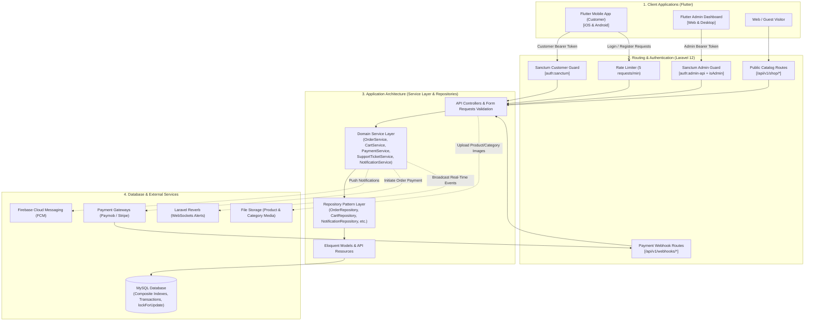
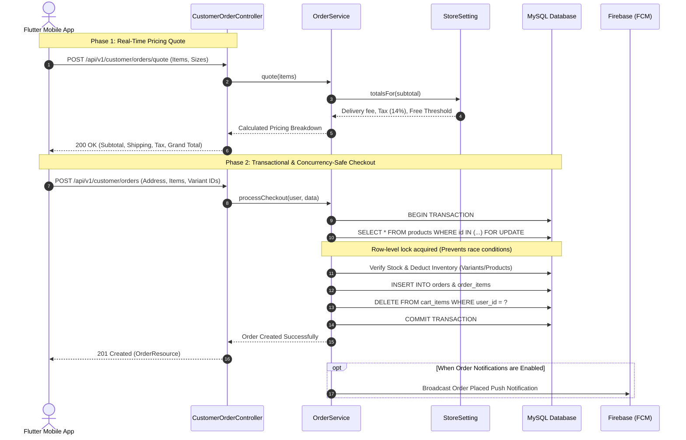

# Stronger Muscles Enterprise Backend 

[](https://laravel.com)
[](https://php.net)
[](https://pestphp.com)
[](https://laravel.com/docs/pint)
[](LICENSE)

**Stronger Muscles Backend** is a high-performance, enterprise-grade RESTful API engineered for the sports nutrition and bodybuilding supplement industry. It serves as the single source of truth for both the customer-facing **Stronger Muscles Mobile App (Flutter)** and the **Admin Dashboard (Flutter Web & Desktop)**.

---

## Key Highlights & Architectural Strengths

- **Clean Architecture & SOLID Principles**: Business logic is decoupled from HTTP controllers using the **Service Layer** and **Repository Pattern**.
- **Dual Sanctum Authentication**: Separate token guard pipelines for customers (`auth:sanctum`) and administrators (`auth:admin-api` + `isAdmin` RBAC middleware).
- **Concurrency & Inventory Locking**: Critical operations like checkout use database row-level locking (`lockForUpdate` within `DB::transaction`) to prevent overselling and race conditions.
- **Multi-Attribute Product Variants**: First-class support for product variants separated by flavor, size, and SKU with variant-level stock management and pricing.
- **Dynamic Pricing Engine (`/orders/quote`)**: Live price calculations enforcing delivery thresholds, taxes, and promotional discounts prior to order creation.
- **Customer Support & Ticketing System**: Multi-channel issue tracking with staff assignments, priority levels, live messaging threads, and internal staff notes.
- **Real-Time Push Notifications**: Firebase Cloud Messaging (FCM) integration with unread counters, read-state synchronization, and admin broadcasts.
- **Optimized Database Schema**: Custom composite indexes for fast catalog lookups, best-seller sort, and real-time dashboard aggregates.

---

## System Architecture & Workflows

### 1. High-Level Architecture Diagram
The following diagram illustrates the complete end-to-end ecosystem, showing how client applications communicate through the authentication and routing layers down to the core service domain, data repositories, and third-party integrations:



### 2. Concurrency-Safe Order Lifecycle Sequence
Critical e-commerce flows (such as cart pricing quotes and checkout execution) utilize pessimistic row-level locking (`lockForUpdate`) within database transactions to guarantee data consistency and eliminate inventory overselling:



---

## Tech Stack

| Component | Technology | Description |
|---|---|---|
| **Language** | PHP 8.4+ / 8.5 | Typed properties, constructor promotion, readonly classes |
| **Framework** | Laravel 12.x | Modern streamlined architecture (no legacy `Kernel.php`) |
| **Authentication** | Laravel Sanctum v4 | Secure, revocable Bearer tokens with multi-guard support |
| **Testing Suite** | Pest PHP 4.x / PHPUnit 12 | 235 automated Feature and Unit tests |
| **Code Formatter** | Laravel Pint | Automatic PSR-12 / Laravel code styling enforcement |
| **Push Notifications** | Firebase Cloud Messaging | `kreait/laravel-firebase` |
| **Broadcasting** | Laravel Reverb v1 | WebSocket broadcasting ready for real-time order alerts |
| **API Documentation**| Scramble / OpenAPI v3 | Auto-generated interactive API documentation |
| **Database** | MySQL (Production) / SQLite | High-concurrency relational store with transactional integrity |

---

## Project Structure

```text
├── app/
│   ├── Http/
│   │   ├── Controllers/
│   │   │   └── Api/V1/
│   │   │       ├── Admin/          # Dashboard controllers (Products, Orders, Settings, etc.)
│   │   │       ├── Customer/       # Mobile client controllers (Cart, Orders, Addresses, etc.)
│   │   │       ├── Webhook/        # Payment gateway webhook handlers
│   │   │       ├── AuthController.php
│   │   │       ├── ProductController.php
│   │   │       └── CategoryController.php
│   │   ├── Requests/               # Form Requests with localized Arabic/English validation
│   │   └── Resources/              # Eloquent API Resources enforcing unified JSON output
│   ├── Models/                     # Eloquent Models with strict casts, relationships, and scopes
│   ├── Repositories/               # Data access abstraction layer
│   └── Services/                   # Pure business logic layer (CartService, OrderService, etc.)
├── database/
│   ├── factories/                  # Model factories for robust testing
│   ├── migrations/                 # Schema migrations including performance optimizations
│   └── seeders/                    # Realistic seeders for products, categories, brands, and admins
├── routes/
│   ├── api.php                     # Clean, versioned (v1) API routes
│   └── console.php                 # Artisan console commands
└── tests/
    ├── Feature/                    # Feature tests covering every API endpoint and workflow
    └── Unit/                       # Unit tests for domain models and isolated helpers
```

---

## Getting Started

### Prerequisites
- **PHP** >= 8.4 (with `pdo`, `mbstring`, `openssl`, `tokenizer`, `xml`, `ctype`, `json`, `bcmath`, `curl`)
- **Composer** 2.x
- **MySQL** 8.0+ or **MariaDB** 10.5+ (or SQLite for local development)
- **Node.js** & **npm** (for building frontend assets if applicable)

### 1. Clone the Repository
```bash
git clone https://github.com/your-username/stronger_muscles_dateabase.git
cd stronger_muscles_dateabase
```

### 2. Install PHP Dependencies
```bash
composer install
```

### 3. Environment Configuration
Copy the example environment file and configure your credentials:
```bash
cp .env.example .env
php artisan key:generate
```

Update your `.env` database settings:
```ini
DB_CONNECTION=mysql
DB_HOST=127.0.0.1
DB_PORT=3306
DB_DATABASE=stronger_muscles
DB_USERNAME=root
DB_PASSWORD=your_password
```

### 4. Run Migrations & Seed Data
```bash
php artisan migrate --seed
```

### 5. Launch the Development Server
```bash
php artisan serve
```
The API is now running locally at: `http://127.0.0.1:8000/api/v1`

---

## Testing & Code Quality

The application maintains 100% test passing integrity across all business logic, validation rules, and controllers.

### Run Automated Tests
```bash
php artisan test --compact
```
*(Runs 235+ Pest tests covering happy paths, edge cases, authentication guards, and validation errors).*

### Run Code Formatter
```bash
vendor/bin/pint --format agent
```

---

## Client Applications Ecosystem

The Stronger Muscles platform includes two client applications that interface with this backend:

| Application | Path / Repository | Description |
|---|---|---|
| **Mobile App (Customer)** | `flutter_apps/stronger_muscles` | Flutter mobile app featuring GetX state management, multi-language support (AR/EN), cart persistence, checkout, live orders tracking, wishlist, and FCM push notifications. |
| **Admin Dashboard** | `flutter_apps/stronger_muscles_dashboard` | Flutter web/desktop dashboard for inventory control, orders dispatch, real-time alert bells, support ticket management, push broadcast, and store settings. |

---

## API Reference

For the comprehensive, detailed REST API documentation covering all endpoints, headers, payloads, query parameters, status codes, and error formats, refer to:

---> **[README.api.md](README.api.md)**

---

## Security & Best Practices

- **Mass-Assignment Protection**: Explicit `$fillable` attributes configured on all models.
- **SQL Injection Prevention**: Exclusive usage of Eloquent ORM and parameterized queries.
- **Rate Limiting**: Critical endpoints (such as `POST /auth/login` and `POST /auth/register`) are throttled at 5 attempts per minute.
- **Server-Side Price Validation**: Cart item prices and checkout totals are calculated strictly on the backend, ignoring any client-provided price tampering.

---

## License

This software is licensed under the [MIT License](LICENSE).
